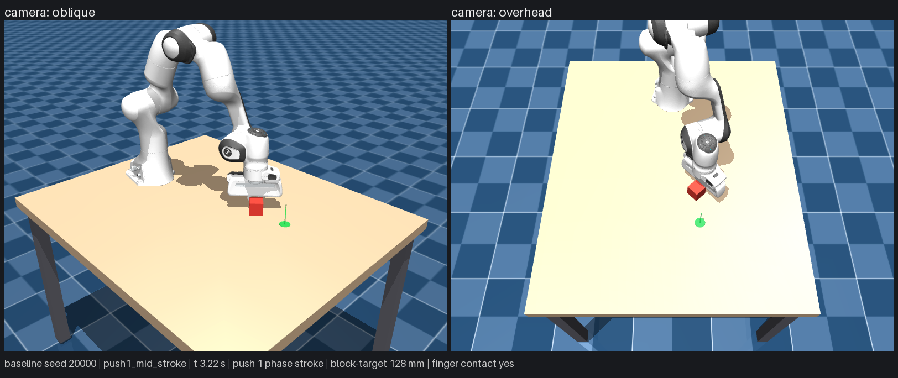

# Physical AI Learning Lab

[](https://github.com/NeuralNomad7/physical-ai-learning-lab/actions/workflows/ci.yml)


A MuJoCo experiment in which a Franka Emika Panda arm pushes a block to a goal on a
table. The block's mass and friction are hidden from the agent and vary between
scenarios. [BUILD_PLAN.md](BUILD_PLAN.md) is the full brief.

## At a glance

**Research question.** Does experience improve performance on unseen physical conditions
under the same action and time budget, without degrading conditions that already worked?

**Why it matters.** Physical AI systems are usually shown as one impressive run. This
project treats a narrow manipulation skill the way a research team would treat a model
release: a pre-written plan, fixed benchmark manifests, sealed held-out splits, a baseline
before any learner, and a gate that each phase must pass with evidence on disk.

| | |
| --- | --- |
| Simulation | MuJoCo 3.14, Franka Emika Panda (MuJoCo Menagerie, pinned and hash-checked), joint-motor control only, no teleporting |
| Hidden variables | Block mass 0.10–0.40 kg and sliding friction 0.20–0.80, never exposed to the agent (tested for leakage) |
| Baseline result | Phase 2 gate: 20/20 nominal episodes (18 required). Phase 3 benchmark: 300/300 on train + validation, a success-rate ceiling that is reported, not hidden |
| Held out | Final-test and retention splits are sealed until a learned candidate is frozen (Phase 5) |
| Engineering | 284 tests, deterministic replay of every run from its seed, SHA-256 manifests for assets and benchmark configs |
| Progress | Phases 1–3 of 7 complete. The learner and persistent memory (Phase 4) come next |

**What this project shows**

- *Research:* a falsifiable question, a narrow claim ("learns a task-specific
  action-to-motion model in simulation"), and explicit non-claims (no real-world transfer,
  no general physical understanding).
- *Engineering:* reproducible simulation, hidden-state boundaries enforced by tests, and
  every number in this README backed by a file in [docs/evidence/](docs/evidence/).
- *Program management:* a phased [build plan](BUILD_PLAN.md) with acceptance gates,
  a [decision log](docs/DECISIONS.md), and a [progress record](docs/PROGRESS.md) with
  post-phase reviews.

**Status:**

- Phase 1 (reproducible simulation) is complete; its gate passed on 2026-10-02.
- Phase 2 (pushing controller and fixed-feedback baseline) is complete; its gate passed on
  2026-10-03 with 20/20 nominal episodes (18 required), before and after its review.
- Phase 3 (benchmark and instrumentation) is built; its gate passed on 2026-10-03. It
  still awaits the post-phase review (BUILD_PLAN.md section 9). The fixed baseline
  succeeded in all 300 benchmark episodes it may run, so the benchmark has no headroom on
  success rate (a ceiling, reported in docs/PROGRESS.md). The final-test and retention
  splits are sealed until a learned candidate is frozen in Phase 5.
- There is no learner, memory or dashboard yet; those are later phases.

Results, evidence and open items are in [docs/PROGRESS.md](docs/PROGRESS.md).



## Watch the baseline push

From the project folder, in PowerShell:

```powershell
.\.venv\Scripts\python.exe -m physical_ai_lab demo --mode baseline --seed 20000
```

The viewer opens and the robot pushes the block to the green goal with its closed gripper,
in real time, through its joint motors only. The top-left text shows the time, the push
number and phase, the block-to-goal distance and whether a finger touches the block. At the
end it shows SUCCESS or the failure reason, keeps the window open for 5 s (`--linger`) and
then closes it. The terminal then reports whether a headless rerun of the same seed gave the
same result.

- `--seed N` picks another layout. Seeds 20000-20019 are the gate episodes.
- `--speed 0.5` plays at half speed; `--duration S` closes the window after S seconds.
- `--frames DIR` does not open a window; it saves offscreen pictures of the start, the
  middle of each push and the end.
- The demo is for watching only; the gate does not use it. You can still rotate and zoom the
  view, but do not push bodies with Ctrl+right drag if you want the rerun to match.
- With the Mesa D3D12 OpenGL driver (seen on Windows on Arm), the top-left text can show
  garbled letters (see below).

To run the 20-episode Phase 2 gate headless (about 50 s here):

```powershell
.\.venv\Scripts\python.exe -m physical_ai_lab gate
```

It prints one line per episode and the result, and writes `gate_log.txt`,
`gate_result.json` and one trajectory file per episode under `runs/phase2/gate/<UTC time>/`.
It exits with 0 only if at least 18 of the 20 episodes succeed.

## Open the scene

To move the arm yourself, from the project folder, in PowerShell:

```powershell
.\.venv\Scripts\python.exe -m physical_ai_lab view --seed 0
```

The viewer runs the seed-0 scenario in real time. Use `--seed N` for other layouts, and
`--randomize-physics` to sample the hidden mass and friction from the seed. While the block
is at rest, different hidden values look identical; that is intended (see below). Close the
window, or press Ctrl+C in the terminal, to exit.

To move the arm, click the 3D view first so that the window has keyboard focus. The status
panel at the top right shows each joint's target, and an orange disc marks the selected
joint.

| Key / mouse | Action |
| --- | --- |
| Up / Down | Select an arm joint, J1 (base) to J7 (flange) |
| Left / Right | Turn the selected joint by one step (Right = positive angle) |
| `-` / `+` | Smaller / larger step: 1, 2, 5, 10 or 20 degrees, 5 at the start (`+` is the `=` key) |
| Enter | Open / close the gripper |
| Home | Back to the home pose with the gripper closed (the block stays where it is) |
| Space | Pause / resume (the keys still set targets while paused) |
| Backspace | Reset to the same seed |
| Left drag / right drag / scroll | Rotate / pan / zoom |
| `[` and `]` | Cycle the fixed cameras (overhead, oblique); Esc returns to the free camera |
| Tab / Shift+Tab | Show / hide the left / right MuJoCo panels (hidden unless `--show-ui`) |
| F1 | MuJoCo help |
| Double-click a body, then Ctrl+right drag | Push it with a force (manual inspection only) |

- The keys and the Control sliders (right MuJoCo panel, Shift+Tab) only set the servo
  targets, clamped to each joint's range. The arm moves through its motors and contacts,
  and the block moves only when the robot pushes it. Each key press is one step; holding a
  key does not repeat.
- The green arrow above the goal and the orange joint disc exist only in the viewer. They
  are not part of the model or of the offscreen renders.
- Any other direct change to the state restores the scenario from its seed, so objects
  cannot be teleported. Direct changes include Backspace, loading a keyframe, the Joint
  sliders, the Equality checkbox and dragging a body while paused. Ctrl+right-drag forces
  act through the physics.
- Edits in the left panel's Physics section (timestep, gravity, solver and contact
  settings) are put back to the scene's values before the next step, and the terminal says
  so. The panel can keep showing the edited number until it is redrawn. A reset also puts
  back the scene's physics options.
- When the window closes, the command replays the run headless from the seed, with your key
  and slider commands since the last reset, and reports whether the final state is
  identical. It differs only if a body was pushed with Ctrl+right drag.
- With the Mesa D3D12 OpenGL driver (seen on Windows on Arm), MuJoCo's own text can show
  garbled letters: the F1 help and the side panels. The status panels on the right are
  drawn as images and are not affected.

## Setup

Tested only on Windows 11 on ARM64 (Qualcomm Adreno X1-85 GPU), with PowerShell 7.6 and
uv 0.12.5. MuJoCo 3.14.0 publishes Windows wheels for x64 only. On ARM64 Windows the project
therefore uses an x64 Python, which Windows runs under emulation; headless stepping still
ran at 44-79x real time here, depending on the load.

```powershell
uv venv --python cpython-3.12-windows-x86_64-none   # x64 Python 3.12 (uv downloads it if needed)
uv sync --locked                                     # exact versions from uv.lock, including pytest
.\.venv\Scripts\python.exe -m physical_ai_lab doctor
```

`doctor` must end with `doctor: all required checks passed`. On an x64 Windows machine,
`uv venv --python 3.12` should be enough (not tested). Always use the project interpreter,
`.\.venv\Scripts\python.exe`: a `python` found on PATH may be a different interpreter
without these packages.

The Panda model files are stored in the project. `doctor` verifies them against a SHA-256
manifest. If any are missing or modified,
`.\.venv\Scripts\python.exe -m physical_ai_lab fetch-assets` downloads them again from the
pinned MuJoCo Menagerie commit; this needs network access.

## Commands

Run each command as `.\.venv\Scripts\python.exe -m physical_ai_lab <command>`; add `--help`
for its options.

| Command | What it does |
| --- | --- |
| `doctor` | Checks Python, the pinned packages, the Panda files, the scene, headless stepping and offscreen rendering |
| `view` | Opens the interactive viewer (`--seed`, `--randomize-physics`, `--duration`, `--screenshot`, `--show-ui`) |
| `step` | Resets and steps headless, then prints the state digest and the observation (`--seed`, `--seconds`, `--json`). Hidden values are printed only with `--show-truth` |
| `render` | Renders the overhead and oblique cameras to PNG files under `runs/render/<UTC time>/` |
| `smoke` | Runs the Phase 1 smoke test: writes `smoke_log.txt`, `smoke_result.json` and screenshots under `runs/smoke/<UTC time>/`, and exits with 0 only if every check passes |
| `gate` | Runs the Phase 2 gate: the baseline on the 20 fixed gate seeds, headless, with logs under `runs/phase2/gate/<UTC time>/`; exits with 0 only if at least 18 succeed (`--seeds development` runs the 30 tuning seeds instead) |
| `demo` | Shows one baseline episode in the viewer (`--mode baseline`, `--seed`, `--speed`, `--duration`, `--linger`, `--show-ui`, `--frames DIR`) |
| `fetch-assets` | Restores the Panda files from the pinned commit (`--force` downloads all of them) |
| `contact-check` | Phase 3 effective-contact and feasibility checks: mass and friction read-back, inertia, resting normal force, kick-test friction, holds and pushes at the ends of the ranges (`--out DIR`; default `runs/phase3/contact_checks/<UTC time>/`). About 70 s |
| `manifests` | `--verify` checks the four benchmark manifests against `configs/manifests/hashes.json`. Without `--verify` it writes them, and refuses because they already exist |
| `evaluate` | Runs an agent on a benchmark split through the separate agent process and writes `episodes.jsonl`, `summary.txt`, `summary.json` and the logged commands under `runs/phase3/evaluate/<split>/<UTC time>/` (`--split train` or `validation`, `--mode baseline`, `--limit N`, `--out DIR`). About 7 min for train, 3.5 min for validation. `--split test` and `--split retention` are refused (exit 2) until a candidate is frozen in Phase 5 |
| `replay` | Replays the first episodes of an `evaluate` run twice, from the logged commands and through a fresh agent, and checks the state bitwise (`--run DIR`, `--count N`, default 2; `--out FILE`) |

The other commands proposed in BUILD_PLAN.md section 10 belong to later phases and do not
exist yet: `collect`, `train` and `dashboard`. `evaluate --mode learner` is rejected until
Phase 4.

Checks:

```powershell
.\.venv\Scripts\python.exe -m pytest                  # 284 tests, about 1 min here
.\.venv\Scripts\python.exe -m physical_ai_lab smoke   # about 11-17 s here
.\.venv\Scripts\python.exe -m physical_ai_lab gate    # Phase 2 gate, about 40-50 s here
.\.venv\Scripts\python.exe -m physical_ai_lab manifests --verify
.\.venv\Scripts\python.exe -m physical_ai_lab evaluate --split validation --mode baseline
uv lock --check --offline                             # uv.lock matches pyproject.toml
```

## The scene

Every value below is in [configs/scene.toml](configs/scene.toml).

- **Frame:** the origin is at the Panda base, the tabletop is the plane z = 0, and +x points
  away from the robot. The table spans x -0.25 to 0.95 m and y -0.5 to 0.5 m.
- **Robot:** the MuJoCo Menagerie Panda, unmodified, with its seven joint position servos
  and its tendon-driven gripper. The gripper is closed at reset. The baseline keeps it
  closed and pushes with the fingertips; only a person in the viewer can open it.
- **Block:** a 5 cm cube on a free joint.
- **Goal:** a green disc of radius 20 mm, the success tolerance on the block centre, with a
  thin pole. It is visual only and never collides.
- **Seeded reset:**
  - the block centre and the goal are uniform in x 0.42 to 0.62 m and y -0.15 to 0.15 m;
  - they are 80 to 200 mm apart;
  - the block yaw is uniform over plus or minus 180 degrees.
- **Hidden physics:** nominally 0.25 kg and block/table sliding friction 0.5.
  - `--randomize-physics` samples mass from 0.10 to 0.40 kg and friction from 0.20 to 0.80.
  - These are the development ranges from BUILD_PLAN.md section 4, not validated operating
    ranges.
- **Timing:**
  - a 2 ms physics step, with 10 steps per 50 Hz control update;
  - the implicitfast integrator;
  - an elliptic friction cone.
- **Cameras:**
  - `overhead` looks down at 60 degrees from beyond the far edge of the table;
  - `oblique` looks at the work area from the far side, to the robot's right.

## What the agent may see

From Phase 3 on, the agent runs in its own process and exchanges JSON messages with the
evaluator ([learner_interface.py](src/physical_ai_lab/learner_interface.py)). It receives
the observations below, the push and time budgets and the control period, and nothing
else; every message is checked against an allow-list and scanned for the scenario's hidden
values and labels (DECISIONS.md D28). Inside that process, agent code receives only `Observation` objects
([observation.py](src/physical_ai_lab/observation.py)), which hold 18 allow-listed fields:

- time and control step;
- the arm's joint positions, velocities and targets;
- the gripper opening;
- the TCP pose;
- the block's pose, yaw and velocities;
- the target position and tolerance;
- robot/block and robot/table contact flags;
- `pose_source`.

The agent cannot observe block mass, inertia or friction, contact forces, the seed or any
scenario identity, or future states. V1 has no perception: poses come straight from the
simulator state, and every observation says so with `pose_source = "simulator_state"`.
The simulator-side handles are for the viewer, renderer, diagnostics and evaluator only:
`ScenarioRunner.sim_model`, `sim_data` and `hidden_truth()`.

At rest, the observation is the same for every hidden mass and friction:

- the difference is exactly 0 at reset;
- it is below 1e-8 after the block settles.

Mass and friction show up only in motion the robot causes, which is what the agent is meant
to learn from.

## How the baseline pushes

Details and evidence are in [docs/DECISIONS.md](docs/DECISIONS.md), D18-D25, and the
settings are in [configs/push.toml](configs/push.toml).

- **One push:** the controller picks a block face, a direction, a speed (0.04, 0.08 or
  0.12 m/s) and a duration (0.5, 1.0 or 1.5 s). The hand rises to 10 cm, moves over the
  face, lowers until the fingertips are about 13 mm above the table, pushes, pauses, backs
  off 3 cm and rises again.
- **Motion:** every 20 ms, inverse kinematics on the controller's own copy of the robot
  model turns the hand position into joint targets for the seven joint motors. The targets
  stay inside the joint ranges and change no faster than 55-61% of the Panda's rated joint
  speeds. The joint motors are position servos that would let the arm sag under its own
  weight, so the controller adds a static gravity offset, computed from the robot's link
  masses and servo gains, and the hand holds the commanded height (D25).
- **Checks before a push:** the hand must stay over the table and above it, the joints must
  be able to reach every point of the path, and the block's predicted end must stay inside
  the allowed area. Pushes that fail any check are not used.
- **Choice:** before each push the controller waits for the block to stop, measures where it
  is, and picks the allowed push whose predicted end is closest to the goal. It stops once
  the block is within 12 mm. It never learns and never sees the block's mass or friction.
- **Judging:** a separate evaluator watches every physics step. It records every contact,
  fails the episode on any robot contact other than the fingers on the block, on a joint
  speed or range limit, a hand below 10 mm, the block leaving the allowed area, more than 8
  pushes or more than 30 s. Success needs the block within 20 mm of the goal, nearly still
  for 0.5 s, with the fingers no longer touching it.

## Reproducibility

A reset rebuilds the whole simulator state from the seed. The same seed therefore gives a
bitwise-identical rollout:

- after other episodes;
- in a fresh runner;
- in a separate process.

On the test machine, seed 0 reaches state digest `9ac3950e3c7ab848` after 5 s.
This is verified on one machine with one MuJoCo build only. Other machines, CPU
architectures and MuJoCo builds were not tested, and their digests may differ.

## Layout

```text
.github/copilot-instructions.md      permanent project rules (BUILD_PLAN.md section 9)
.gitattributes                       stops git changing line endings in hashed and evidence files
assets/scenes/panda_push_scene.xml   the scene (MJCF)
assets/third_party/mujoco_menagerie/ pinned Panda model, its LICENSE and a SHA-256 manifest
configs/scene.toml                   timing, regions, hidden-physics ranges, check tolerances
configs/push.toml                    Phase 2 episode rules, limits, push skill, baseline and seed lists
configs/benchmark.toml               Phase 3 benchmark: rules, cohorts, splits, metrics, statistics, replay, feasibility
configs/manifests/                   the four benchmark manifests and hashes.json (do not edit or regenerate)
freezes/                             Phase 5 candidate-freeze records; must not exist before then
src/physical_ai_lab/                 scenario runner, observation boundary, viewer, renderer, smoke test, CLI,
                                     kinematics, push skill, baseline, evaluator and demo; Phase 3:
                                     benchmark_config, manifest, learner_interface, agent_process,
                                     episode_schema, instrumentation, contact_checks, benchmark
tests/                               pytest suite
docs/                                progress, design decisions, Phase 1 to 3 evidence
runs/                                local outputs; keep out of version control
```

## Troubleshooting

- **"Access is denied" from `uv sync`, or when deleting `.venv` (OneDrive).** OneDrive can
  lock or flag files while it syncs this folder.
  - Pause syncing from the OneDrive taskbar icon, then retry.
  - `pyproject.toml` already sets `link-mode = "copy"`.
  - To remove a stuck `.venv`, run `attrib -R -S -H .venv\* /S /D` and then
    `Remove-Item -Recurse -Force .venv`.
  - Moving the project out of OneDrive avoids the problem.
- **The arrow keys do not move the arm.** Click the 3D view once so that the window has
  keyboard focus. Each press moves one step; holding a key does not repeat. A joint stops
  at the end of its range, and the status panel then shows "(limit)". If the panel shows
  "now" with a second angle, the arm is still moving or a contact is blocking it.
- **`view --screenshot` reports a black image.** The capture asks the window to draw
  itself, and some OpenGL drivers do not support that. Use `render`, which draws offscreen.
- **`python -m physical_ai_lab` says "No module named physical_ai_lab".** You are running
  a different interpreter; use `.\.venv\Scripts\python.exe`.

## Licences

Third-party components and their licences are listed in
[THIRD_PARTY_NOTICES.md](THIRD_PARTY_NOTICES.md). The Panda model is Apache-2.0 and is
used unmodified. The project itself has no licence file yet.
